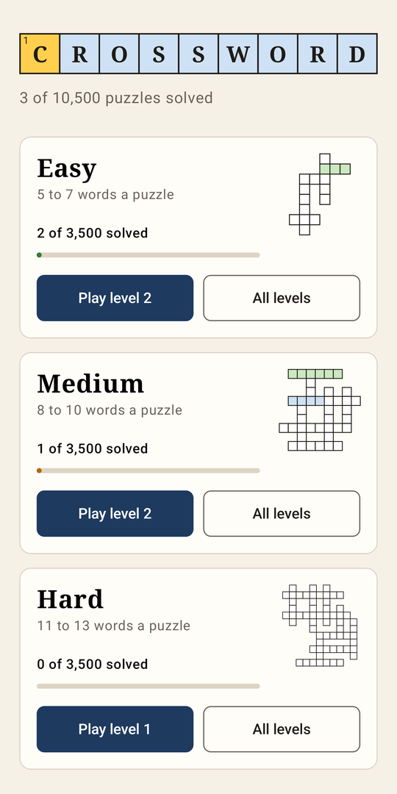
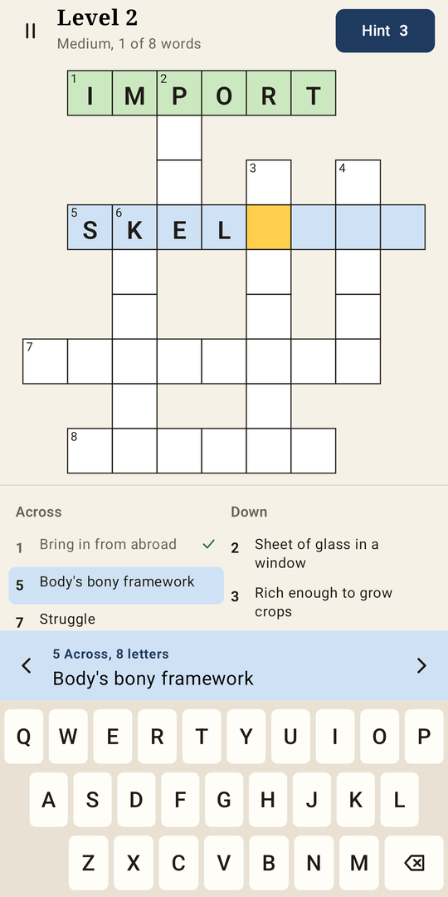
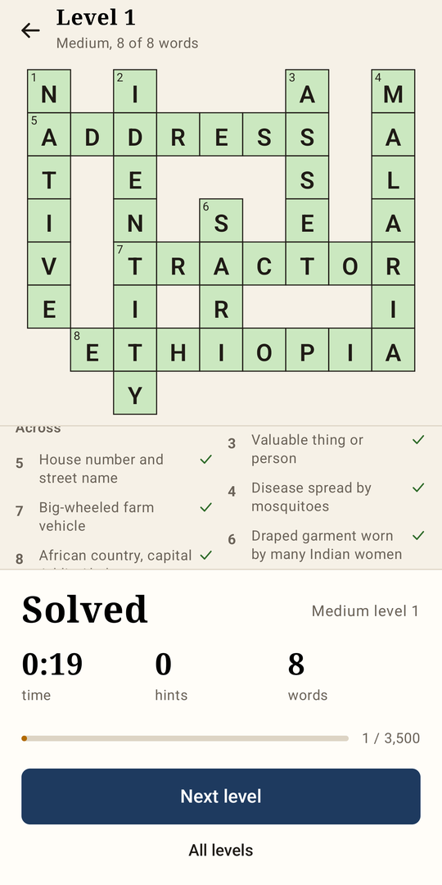
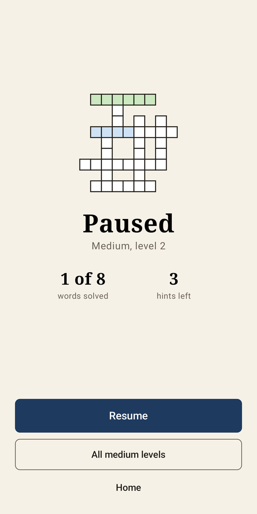
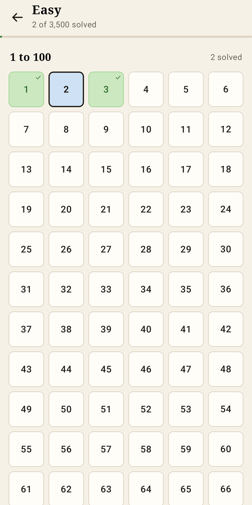

# Crossword

An offline crossword game for Android. 10,500 puzzles in three difficulties, with no ads, no account and no internet permission.

<p align="center">
  
  
  
  
  
</p>

## How it plays

- Pick Easy (8 to 10 words a puzzle), Medium (12 to 14) or Hard (16 to 18). Each has 3,500 levels, all open from the start.
- Type on the built-in keyboard. A right word turns green and locks. A full word that is wrong flashes red, and its letters stay so you can fix them.
- The arrows beside the clue skip words you have already solved.
- Three hints per level. Each fills in one letter.
- Pause hides the grid and stops the clock. Leaving the app in the middle of a level pauses it too.
- Your time shows only when you finish, next to the hints you used.
- Progress saves after every move.

## Install

Download the APK from [Releases](../../releases) and open it on an Android phone running 8.0 or later. Android will ask you to allow installs from your browser or file manager.

The release is signed with a development key. To install a copy you built yourself, uninstall that one first.

## Build

You need JDK 17 or later and the Android SDK with platform 35. Tell Gradle where the SDK is with `ANDROID_HOME` or a `local.properties` file (`sdk.dir=...`).

```sh
./gradlew testDebugUnitTest assembleRelease
```

The APK lands in `app/build/outputs/apk/release/app-release.apk`.

## Where the puzzles come from

The levels are generated ahead of time and ship as plain text in `app/src/main/assets/`. The tools need Python 3 and nothing outside its standard library.

1. `tools/clues/` holds 7,172 answers with their first clue, a plain definition, one `WORD<TAB>Clue` per line, split by first letter and difficulty.
2. `tools/clues/alt/` holds each answer's second clue, in a file with the same name as its first-clue file and the same words in the same order, one `WORD<TAB>STYLE<TAB>Clue` per line. STYLE is one of `BLANK`, `PAIR`, `EXAMPLE`, `FACT`, `LINK`, `SPEECH`, `PUN`, `MISDIRECT` or a cryptic tag (`CRYPTIC-HIDDEN`, `CRYPTIC-INITIALS`, `CRYPTIC-ANAGRAM`, `CRYPTIC-DOUBLE`, `CRYPTIC-CHARADE`, `CRYPTIC-REVERSAL`). Each difficulty allows only some tags, and only Hard has cryptic clues. `tools/clue-style-guide.md` says how to write each one.
3. `python tools/check_clues.py` checks both sets of files. For every clue: answer lengths for each difficulty, 55 characters or fewer, ASCII only, no full stop at the end, American spelling, nothing in the clue that gives away its own answer. For second clues: the same words in the same order as the first-clue file, a tag the difficulty allows, a clue that differs from clue 1, and a tag that fits the clue (one `___` for `BLANK`, a question mark for `PUN`, none for `MISDIRECT`, and for a cryptic clue the right letter count plus the hidden word, initials or anagram it claims). Last, each difficulty's mix of tags has to land within 5 points of its target.
4. `python tools/generate_puzzles.py` builds 3,500 freeform grids per difficulty. The same clue files always produce the same levels. Each word in a level shows one of its two clues. The tiers run as separate processes, so they can run side by side. Measured with Easy and Medium running together, Easy took 63 seconds and Medium 165. Hard took HARD_SECONDS seconds.
5. `LevelAssetsTest` parses all 10,500 levels with the app's own parser and checks grid sizes, word counts, that every word has an answer and two clues, and that every grid is connected.

The clues were drafted with an AI model and checked by the script above. Each second clue was also read by a separate AI reviewer. The first clues were only sampled, so expect the odd weak one. Fixes are welcome.

## Project layout

```
app/src/main/java/com/crossword/game/
  model/      Puzzle, GameState (typing, locking, checking), Hints
  data/       Level loading and saved progress
  ui/         Compose screens: home, level list, game, pause menu
tools/        Clue lists, the clue checker and the level generator
docs/         Screenshots
```

Written in Kotlin with Jetpack Compose. The grid, keyboard and icons are drawn in Compose, so the app uses nothing beyond AndroidX.

## License

MIT. See [LICENSE](LICENSE).
