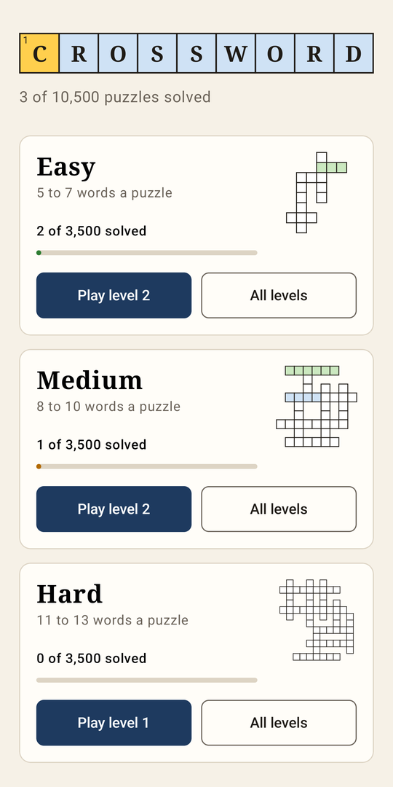
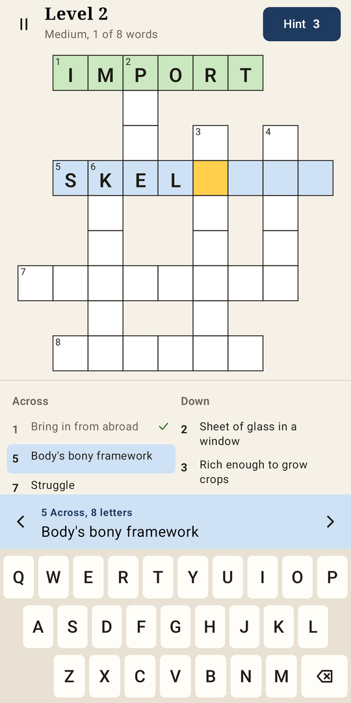
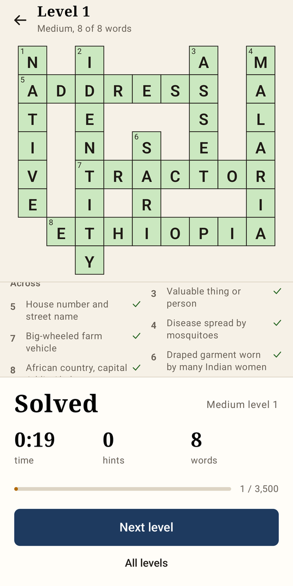
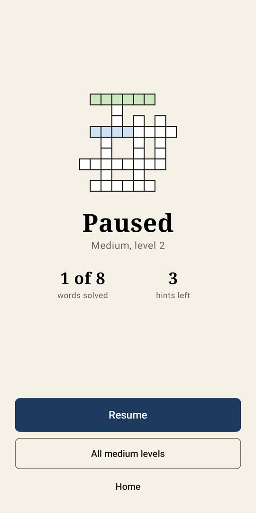
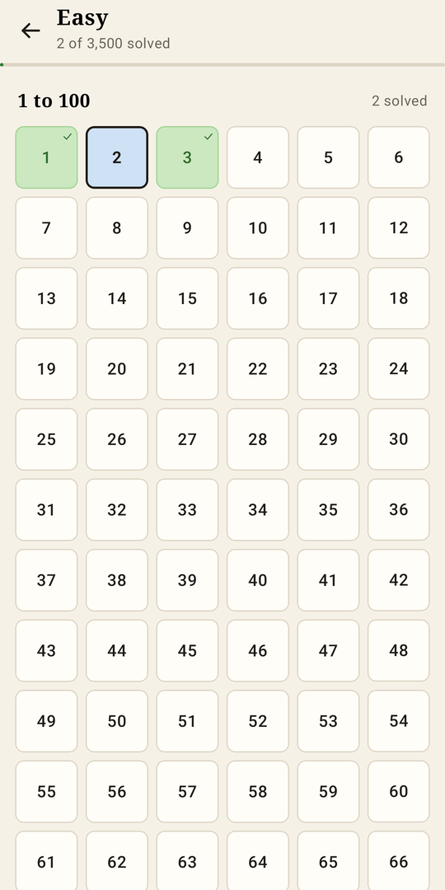

# Crossword

An offline crossword game for Android. 10,500 puzzles in three difficulties, with no ads, no account and no internet permission.

<p align="center">
  
  
  
  
  
</p>

## How it plays

- Pick Easy (5 to 7 words a puzzle), Medium (8 to 10) or Hard (11 to 13). Each has 3,500 levels, all open from the start.
- Type on the built-in keyboard. A right word turns green and locks. A full word that is wrong flashes red, and its letters stay so you can fix them.
- The arrows beside the clue skip words you have already solved.
- Three hints per level. Each fills in one letter.
- Pause hides the grid and stops the clock. Leaving the app in the middle of a level pauses it too.
- Your time shows only when you finish, next to the hints you used.
- Progress saves after every move.

## Install

Download the APK from [Releases](../../releases) and open it on an Android phone running 8.0 or later. Android will ask you to allow installs from your browser or file manager.

The release is signed with a development key. To install a copy you built yourself, uninstall that one first.

## Build

You need JDK 17 or later and the Android SDK with platform 35. Tell Gradle where the SDK is with `ANDROID_HOME` or a `local.properties` file (`sdk.dir=...`).

```sh
./gradlew testDebugUnitTest assembleRelease
```

The APK lands in `app/build/outputs/apk/release/app-release.apk`.

## Where the puzzles come from

The levels are generated ahead of time and ship as plain text in `app/src/main/assets/`. The tools need Python 3 and nothing outside its standard library.

1. `tools/clues/` holds 7,172 answers with their clues, one `WORD<TAB>Clue` per line, split by first letter and difficulty.
2. `python tools/check_clues.py` checks them: answer lengths for each difficulty, clues of 55 characters or fewer, no answer inside its own clue, no duplicates.
3. `python tools/generate_puzzles.py` builds 3,500 freeform grids per difficulty. The same clue files always produce the same levels. A full run takes about 20 minutes.
4. `LevelAssetsTest` parses all 10,500 levels with the app's own parser and checks grid sizes, word counts and that every grid is connected.

The clues were drafted with an AI model and checked by the script above. Only a sample was read by hand, so expect the odd weak clue. Fixes are welcome.

## Project layout

```
app/src/main/java/com/crossword/game/
  model/      Puzzle, GameState (typing, locking, checking), Hints
  data/       Level loading and saved progress
  ui/         Compose screens: home, level list, game, pause menu
tools/        Clue lists, the clue checker and the level generator
docs/         Screenshots
```

Written in Kotlin with Jetpack Compose. The grid, keyboard and icons are drawn in Compose, so the app uses nothing beyond AndroidX.

## License

MIT. See [LICENSE](LICENSE).
